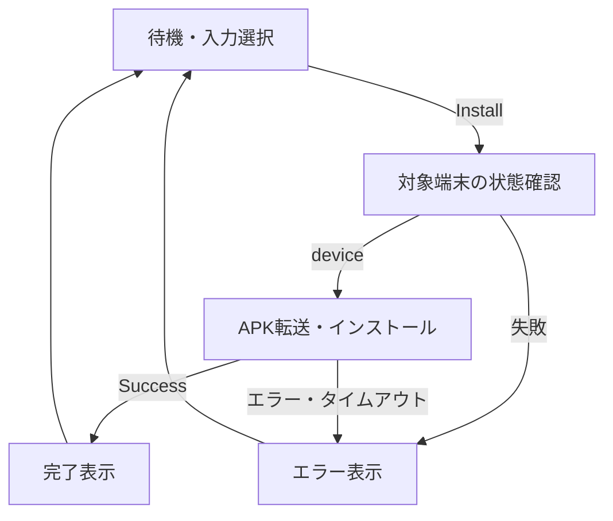

# ADB APK Installer — 要求仕様・設計・引き継ぎ情報

- 作成日：2026-11-06（日本時間）
- 文書版：1.2
- 対象実装：同梱の `adb_apk_installer.py`（状態表示の修正版）
- 対象環境：Windows / Python **3.11.9**
- 目的：独立プロジェクトへ移行する際に、会話履歴を参照せず開発を継続できるようにする。

## 1. 目的と範囲

PC上の単体APKを、ADBで接続されたAndroid端末に簡単なGUIからインストールする。
コマンド入力が不要で、利用者はADBの場所、APK、接続先を選んで実行できること。
最終的にはWindows実行ファイルとして配布し、利用者にPythonの導入を要求しない。

今回のアプリはAPKインストール専用。Bluetooth SPP通信、UUID選択、ADBのTCPポート転送、Androidアプリの起動は含めない。

## 2. ユーザー要求と実装の対応

| ID | 要求 | 現在の実装 |
|---|---|---|
| REQ-01 | 簡潔なGUI | Tkinter/ttk、1画面 |
| REQ-02 | 起動時に接続中Android端末の情報を表示 | 起動後に `adb devices -l` を実行 |
| REQ-03 | ダイアログでadb.exeを指定 | Select adb.exe |
| REQ-04 | PATH登録済みならADBを指定せず使用 | `shutil.which` による自動検出 |
| REQ-05 | ダイアログでAPKを指定してインストール | Select apk / Install |
| REQ-06 | 指定したADBパスを次回以降も記憶 | ユーザー別JSONに保存・起動時復元 |
| REQ-07 | APKパスも次回以降に記憶 | 同上 |
| REQ-08 | Python 3.11.9を前提 | 標準ライブラリのみ。セットアップ時に3.11.9を確認 |
| REQ-09 | 将来的に実行ファイル化 | PyInstaller用ビルドバッチを同梱 |
| REQ-10 | device情報に型番を表示 | Model列。`ro.product.model` を取得 |
| REQ-11 | 最下段の動作表示を改善 | 進捗バーを処理状態・動くインジケーター・経過時間に置換 |
| REQ-12 | 設計・入力仕様をMDとして残す | 本文書 |

実装上の補助機能として、複数端末の選択、Refresh、Auto detect、処理ログ、非同期実行、エラー表示を追加している。
これらの具体的な配置・タイムアウト値等は実装時の選択であり、変更不可のユーザー要求ではない。

## 3. 入力仕様

| 入力 | 取得元・形式 | 必須条件・検証 | 保存 |
|---|---|---|---|
| ADBパス | ファイル選択または自動探索による実行ファイルのフルパス | ファイルが存在すること。実行可能かは `adb version` 実行で確認 | `adb_path` |
| APKパス | ファイル選択による単体 `.apk` のフルパス | ファイルが存在し、拡張子が大文字小文字を区別せず `.apk` であること | `apk_path` |
| 対象端末 | 端末一覧の単一選択 | `state == device`。インストール直前にも対象serialで状態確認 | 保存しない |
| 実行指示 | Installボタン | 処理中ではなく、ADB/APK/端末の条件を満たすこと | 保存しない |

- パス欄は読み取り専用。変更はファイル選択ボタンから行う。
- 日本語・空白を含むパスは、文字列の引数リストとしてsubprocessへ渡す。
- APKの署名、パッケージ名、バージョン、ABI、SDK条件は事前解析しない。Android側のインストール結果で判定する。
- シリアル番号は一覧から得た値をそのまま使う。`192.168.x.x:port` 等の既にADB接続済みの端末も扱えるが、このアプリ自身は無線ADBのペアリング・接続設定を行わない。

## 4. GUI仕様

ウィンドウタイトルは `ADB APK Installer`。初期サイズ780×640、最小サイズ680×580。
Windowsで利用できる場合はttkのvistaテーマを使用する。

上から次の順で配置する。

| 領域 | 表示・操作 |
|---|---|
| ADB information | PATH、ADBバージョン、Select adb.exe、Auto detect |
| ADB Device information | Serial / State / 型番 (Model) / Product の一覧、Refresh、選択方法の説明 |
| APK | APKフルパス、Select apk、Install、データ保持で更新する旨の説明 |
| ログ | ADB情報、端末一覧出力、インストール先とAPK、ADB応答・エラー |
| 処理表示 | 動くインジケーター、処理段階、経過時間。終了後は結果と処理時間 |
| ステータス | 次に行う操作、未検出・接続許可等の案内、実行結果 |

### 4.1 端末一覧

- `device` の端末が1台だけなら自動選択する。
- 複数の使用可能端末がある場合は明示選択を必要とする。
- Refresh後も直前の選択端末が使用可能なら、その選択を維持する。
- 再起動時には端末選択を復元しない。
- `unauthorized` / `offline` 等も表示するが、これらを選択してもInstallは有効にならない。
- 型番は許可済み端末に対して `getprop ro.product.model` を実行する。空白を保持する。
- 型番取得が空、失敗、タイムアウトの場合は `devices -l` のmodel値を使用する。取得エラーはログへ記録し、一覧更新全体は継続する。
- 型番はメーカーが設定した値を表示する。販売名称や地域別型番への変換表は持たない。
- 一覧更新は起動時、Refresh、ADB選択・自動再検出時。定期更新は行わない。

### 4.2 操作可否

処理中はADB/APK選択、Auto detect、Refresh、Installを無効化し、端末一覧もdisabled状態にする。
インストール先serial・ADBパス・APKパスは開始時に固定するため、UIの状態が変わっても実行中の対象を変更しない。
処理中に通常のウィンドウ終了を要求された場合は案内を表示し、処理完了後まで終了しない。

### 4.3 最下段の表示

初期版はindeterminateモードのプログレスバーだった。これは処理中の表示であり、転送率を取得していなかった。
ユーザーから動作が分かりづらい旨の報告を受け、修正版ではバーを使用しない。

- 待機：`待機中` またはADB未指定の案内。
- 検出中：`ADB・端末情報を取得中` と動くインジケーター、経過 `mm:ss`。
- インストール前：`インストールを準備中` → `接続先の状態を確認中`。
- 実行中：`APKを転送・インストール中` と経過時間。
- 成功：`確認完了` / `インストール完了` と処理時間（秒）を保持。
- 失敗：`失敗` と処理時間を保持。詳細はログへ表示。

経過時間は `time.monotonic()` を使用する。インジケーターは約1/3秒ごとに位置を変える。
**経過時間やアニメーションは実データ転送の進行量を示さない。転送率、残り時間、擬似パーセントは表示しない。**
転送とインストールは1回の `adb install` で実行するため、両工程の切り替わりも現実装では判定しない。

## 5. 設定保存仕様

Windowsの保存先：`%APPDATA%\ADB_APK_Installer\settings.json`

APPDATAが存在しない環境では `~/.config/ADB_APK_Installer/settings.json` を使用する。
exeやソースのフォルダとは独立した、OSユーザー単位の設定である。

```json
{
  "adb_path": "C:\\Android\\platform-tools\\adb.exe",
  "apk_path": "C:\\APK\\test_app.apk"
}
```

| 項目 | 動作 |
|---|---|
| 保存契機 | ADB選択、APK選択、Auto detect、Install開始前 |
| 形式 | UTF-8 JSON、文字列2項目 |
| 保存方法 | 同じディレクトリの一時ファイルへ書き、`os.replace` で置換 |
| 設定なし | 初期設定として起動し、ADBを探索 |
| JSON破損・読み込み失敗 | 空設定で起動し、ログに警告 |
| 不明キー・非文字列値 | 読み込み対象から除外 |
| 保存失敗 | 警告ダイアログとログを表示。現在の選択値での利用は継続 |
| 保存先のADBが消失 | 元パスを保持してエラー表示。別のADBへ黙って切り替えない |
| 保存先のAPKが消失 | 元パスを保持し、再指定を案内。Installは無効 |

自動検出したADBパスは、起動して検出しただけでは書き込まない。上記の保存契機で現在のADB/APKパスを一緒に保存する。
設定スキーマのversionキーは現時点ではない。将来拡張する場合も既存2キーを引き継ぐこと。

## 6. ADBの探索順

1. 保存済みのADBパスが空でなければ採用する。
2. PATHを `shutil.which("adb.exe")` で探索する。
3. アプリと同じフォルダの `adb.exe` を探す。
4. アプリのフォルダ内の `platform-tools\adb.exe` を探す。
5. 見つからなければ手動選択を案内する。

「アプリのフォルダ」は、Python起動時はソースファイルの場所、PyInstaller版では `sys.executable` の親フォルダとする。
Auto detectは保存済みパスを無視して2以降から探索し直し、その結果を保存する。
設定済みAPKパスはAuto detectでは変更しない。

## 7. 外部コマンド仕様

| 用途 | 引数（ADB実行ファイルの後） | タイムアウト | 結果の扱い |
|---|---|---|---|
| ADB確認 | `version` | 30秒 | 先頭行をGUI表示、全体をログへ |
| 端末一覧 | `devices -l` | 30秒 | serial/state/model/productを解析 |
| 型番詳細 | `-s SERIAL shell getprop ro.product.model` | 端末ごとに5秒 | 成功時はmodel値を上書き |
| 接続先確認 | `-s SERIAL get-state` | 30秒 | 応答が `device` であることを要求 |
| APK導入 | `-s SERIAL install -r APK_PATH` | 300秒 | 終了コード0かつ単独行 `Success` で成功 |

- インストールは選択したserialを必ず `-s` で指定する。対象消失時に他端末へフォールバックしない。
- `-r` を使用し、既存アプリはデータ保持の更新を試みる。
- `uninstall`、データ削除、ダウングレード許可、権限一括許可は自動実行しない。
- `subprocess.run` にリストで引数を渡し、シェルを介さない。
- 標準入力はDEVNULL。標準出力・標準エラーはPIPEで取得する。
- 応答はUTF-8、デコード不能箇所は置換。stdoutの後にstderrを連結して表示するため、両者の厳密な時系列は保存しない。
- Windowsでは `CREATE_NO_WINDOW` によりADB用コンソールを表示しない。
- タイムアウト時はPythonが起動したADBクライアントの処理を終了するが、端末側の処理の終了・ロールバックを保証しない。
- 端末側の許可画面・管理ポリシー等は回避しない。

## 8. 処理構成

実装は現時点で1つのPythonファイルにまとめる。

| 単位 | 主な責務 |
|---|---|
| `settings_path`, `load_settings`, `save_settings` | 設定場所、読み書き、破損時の扱い |
| `detect_adb` | 保存値とPATH・配置先からのADB解決 |
| `Device` | serial/state/model/productの不変データ |
| `parse_devices` | ADB一覧テキストの解析 |
| `run_adb` | subprocess実行、応答収集、タイムアウト・エラー変換 |
| `read_devices` | 一覧取得と許可済み端末の型番補完 |
| `install_apk` | 入力チェック、接続先確認、インストール、成功判定 |
| `InstallerApp` | GUI、設定反映、操作制御、ワーカー・イベント処理 |

### 8.1 スレッドとイベント

- GUI操作はTkのメインスレッドで行う。
- ADB処理はdaemonワーカースレッドで実行する。同時に1処理まで。
- ワーカーからGUIのウィジェット・StringVarを直接操作しない。
- `queue.Queue` に `(kind, payload, error)` のタプルを送る。
- `kind` は `stage` / `refresh` / `install`。
- `stage` は途中段階の通知。busy解除や完了処理をしない。
- `refresh` / `install` は最終結果。エラーはerrorへ文字列で入れる。
- メインスレッドが `after(80, ...)` でイベントを回収し、処理表示も更新する。
- ADBの標準出力はコマンド終了後に収集する。現時点ではリアルタイム行ログではない。

### 8.2 インストールの状態遷移



完了・失敗の表示は、次の処理を開始するまで保持する。

## 9. エラー処理

| 状況 | 表示・動作 |
|---|---|
| ADB未指定・未検出 | 手動選択案内、インストール不可 |
| ADBの起動失敗 | パス・依存DLL等のエラーをログへ表示 |
| 端末なし | USB接続・USBデバッグ確認とRefreshを案内 |
| unauthorized | 端末上でUSBデバッグ許可後Refreshを案内 |
| offline | 再接続・Refreshを案内 |
| 型番のみ取得失敗 | 既存model値を残し、ログに警告、一覧取得継続 |
| APK不存在・拡張子不正 | Install無効。実行関数でも再検証 |
| インストール直前の接続切れ | 対象serialの状態確認で失敗、処理を中止 |
| Androidのインストール拒否 | ADB応答をログとエラーダイアログへ表示 |
| 終了コード0だがSuccessなし | 成功未確認として扱う |
| インストールタイムアウト | 端末側で継続している可能性を案内。自動再試行しない |

ADBサーバーの強制再起動や `kill-server` は行わない。他のADB利用アプリへの影響を避ける。

## 10. 実行・ビルド・配布

| ファイル | 用途 |
|---|---|
| `adb_apk_installer.py` | アプリ本体 |
| `setup.bat` | Python 3.11.9の仮想環境を作成・確認 |
| `run.bat` | `.venv\Scripts\python.exe`でソース起動 |
| `test.bat` | 仮想環境で`tests`内の自動テストを実行 |
| `build_exe.bat` | 共通の仮想環境にPyInstallerを導入してexe化 |
| `requirements-build.txt` | ビルド時依存 `pyinstaller==6.22.3` |
| `tests/test_installer.py` | ADBを模擬した自動テスト |
| `README.md` | 操作・セットアップ手順 |
| `docs/ADB_APK_Installer_Design.md` | 本設計情報 |

- ビルドはWindows上で実行する。
- 出力先：`dist\ADB_APK_Installer.exe`。
- オプション：`--onefile --windowed`。Python/Tkinterを含めて配布する。
- ADBとその必要DLLはexeに含めない。Platform-Toolsを別途配置し、ADB選択またはPATHで参照する。
- 開発者のローカルパスや設定JSONを配布物に含めない。
- 初回ビルドにはPyInstaller等のダウンロードが必要。

## 11. 検証状況と受け入れ確認

Python 3.11.17（Linux）で既存の自動テスト16件に合格。
主に、設定保存・復元、破損設定、PATH探索、複数状態の一覧解析、型番取得、対象serialの固定、日本語・空白パス、ADB異常終了、タイムアウト、成功応答判定を確認した。
修正版も同じ16件の回帰テストと構文チェックを通過した。

初期版についてユーザーから「ほぼOK」との実行報告があり、最下段のバー表示に指摘があった。
修正版のWindows上の描画、実機インストール、exeビルド・実行は、初版の作成環境では未検証だった。自動テストの合格を実機検証済みとは扱わない。

2026-11-06のプロジェクト移行時に、Windows / Python 3.11.9の`.venv`で自動テスト16件の合格と、依存パッケージの整合性を確認した。
Tkinterのウィンドウ生成と、ADB探索を模擬した`InstallerApp`の生成・イベントループも確認した。
PyInstaller 6.22.3で`dist\ADB_APK_Installer.exe`のビルドに成功した。
画面の目視確認、生成exeの起動、実機へのインストールは未検証。

プロジェクト移行後の確認項目：

| 項目 | 期待結果 |
|---|---|
| PATHにADBがある初回起動 | 手動指定なしでADB・端末情報を表示 |
| PATHにADBがない初回起動 | ADB選択で利用可能になる |
| ADB/APK選択後の再起動 | 両方のフルパスを復元 |
| ファイルが移動・削除された状態 | 再指定を促し、誤って別ファイルを実行しない |
| 未許可端末→許可→Refresh | unauthorizedからdeviceへ変わり、型番を表示 |
| 使用可能端末が複数 | インストール先の明示選択ができる |
| 日本語・空白を含むAPKパス | 正常にインストールできる |
| 実行前・実行中に切断 | エラーとなり、別端末へ切り替わらない |
| 長めのインストール | GUIが応答し、状態表示と経過時間が更新される |
| 成功／失敗後 | インジケーター停止、結果と処理時間を保持、操作再開 |
| 短時間で完了する情報取得 | アニメーションが目立たなくても確認完了と時間が残る |
| Windows表示倍率100% / 150% / 200% | 主要ボタン・パス・型番・状態表示が使用可能 |
| exe配布 | PythonなしのWindowsで起動し、外部ADBを選べる |

## 12. 未実装・制約・将来検討

以下は将来の検討候補であり、今回の確定要求ではない。

- APKメタデータの事前表示（パッケージ名、バージョン等）。
- 分割APK、APKS、XAPK、AABへの対応。
- 複数端末への一括インストール。
- 実転送率の取得、進行状況のリアルタイム行表示。
- キャンセル。導入時はPC側プロセス停止と端末側処理継続を区別する設計が必要。
- 端末一覧の定期更新・接続イベント追従。
- Androidアプリの自動起動、ログのファイル保存。
- 設定ファイルのスキーマバージョン、複数起動時の競合対策。

現状の補足：型番の追加取得は端末ごとに順次行うため、応答しない端末が多数あると一覧更新に時間がかかる。ログはメモリ上で追記され、上限や自動保存を持たない。

## 13. 独立プロジェクト化の方針

1. 同梱ファイルを新しいプロジェクトの起点にする。
2. `.venv`、`__pycache__`、`build`、`dist`、個人設定はバージョン管理に含めない。
3. Python 3.11.9でテストを実行し、Windows・実機の受け入れ確認を行う。
4. 機能が増えた時点で、GUI・ADB操作・設定管理を分割する。小規模な間は単一ファイルを維持してよい。
5. 既存の設定保存先と `adb_path` / `apk_path` は移行後も引き継ぐ。
6. コマンド・入力項目・表示仕様を変えたら、本書とREADMEも同じ変更で更新する。

## 14. 参考資料

- Android Debug Bridge: https://developer.android.com/tools/adb
- Android端末のMODEL情報: https://developer.android.com/reference/android/os/Build#MODEL
- SDK Platform-Tools: https://developer.android.com/tools/releases/platform-tools
- PyInstaller利用方法: https://pyinstaller.org/en/stable/usage.html
- PyInstallerの対象OS: https://pyinstaller.org/en/stable/operating-mode.html
